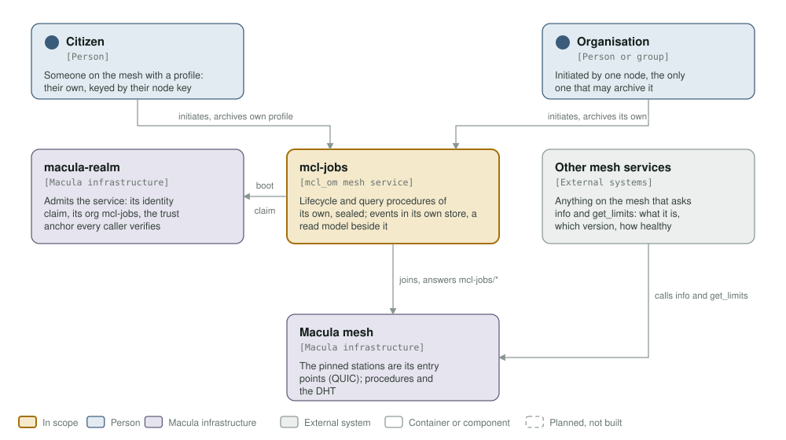
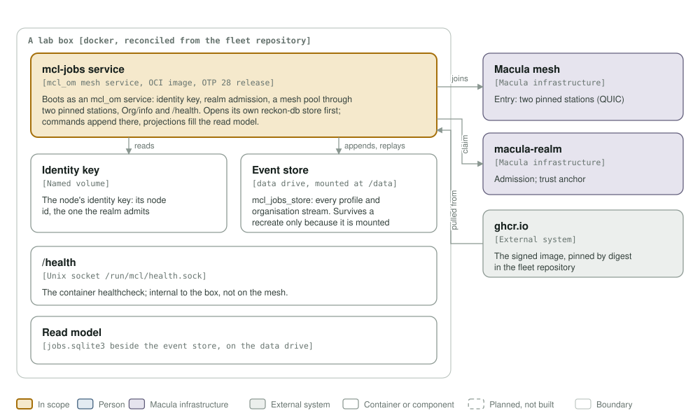
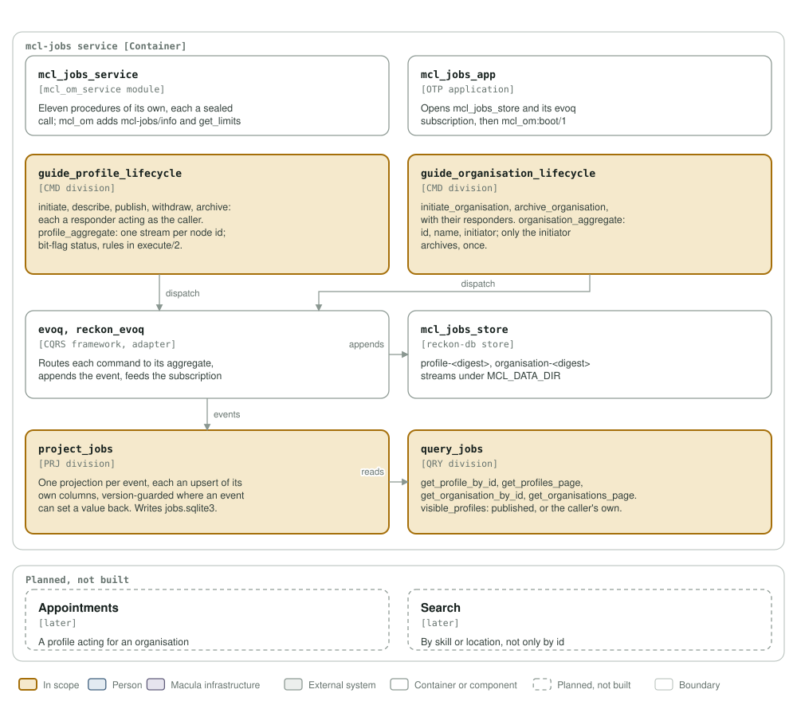

# mcl-jobs architecture

This exists so a person's working life (their profile, the organisations they
work with) lives on the Macula mesh rather than on a platform that owns it.

**Status: eleven procedures of its own over two CMD divisions and one read model.** The
service boots, joins the mesh, answers `mcl-jobs/info` and `mcl-jobs/get_limits`,
the pair `mcl_om` adds to every service, `/health` on its Unix socket, and answers
its own procedures only to a sealed call. Profiles and
organisations live in `mcl_jobs_store`; `jobs.sqlite3` answers the queries.
Search and appointments are planned, not built.

The model follows [C4](https://c4model.com): context, containers, components.
The diagrams are generated by `architecture/c4_diagrams.py` into `assets/`;
change the script, run it, and look at the result before committing.

## Level 1: system context

| Element | Role |
|---------|------|
| mcl-jobs | An `mcl_om` mesh service. Lifecycle procedures for profiles and organisations, query procedures to find them, every procedure of its own sealed; events in its own store, a read model beside it. |
| Citizen | Someone on the mesh with a profile, keyed by their node key. Initiates and archives only their own. |
| Organisation | A company, cooperative or project, initiated by one node, the only one that may archive it. A profile appointed to act for one (a recruiter) is later work. |
| macula-realm | Admits the service: its identity claim, its org `mcl-jobs`, the trust anchor callers verify. |
| Macula mesh | The pinned stations are the entry points; procedures and the DHT. |
| Other mesh services | Call `mcl-jobs/info` and `mcl-jobs/get_limits`, which `mcl_om` adds to every service: name, version, health word, the advertised procedures, and each procedure's guard limits. |

## Level 2: containers

One OTP release in one image, run under docker on a lab box that reconciles
from the fleet repository, with its store on the box's data drive. What `mcl_om` provides: the node identity key on a named
volume, realm admission, a mesh pool through the pinned stations, `mcl-jobs/info`
and `mcl-jobs/get_limits`, and `/health` on the Unix socket `/run/mcl/health.sock` (the container
healthcheck, never on the mesh). What the service adds: its own reckon-db store,
`mcl_jobs_store`, and the SQLite read model `jobs.sqlite3` beside it, both on the
volume `MCL_DATA_DIR` points at. Each of its own procedures requires a sealed call
(`kem_advertise` enabled).

## Level 3: components

| Component | Department | What it does |
|-----------|-----------|--------------|
| `mcl_jobs_service` | service contract | The six `mcl_om_service` callbacks. Announces eleven procedures of its own, each `confidential => required`; asks for no topic authority. |
| `mcl_jobs_app` | service contract | Opens `mcl_jobs_store` and its evoq subscription, then `mcl_om:boot/1`. |
| `guide_profile_lifecycle` | CMD | Desks `initiate_profile/`, `describe_profile/`, `publish_profile/`, `withdraw_profile/`, `archive_profile/`, each with its responder; `profile_aggregate`, one stream per caller node id. |
| `project_jobs` | PRJ | One projection per event into `jobs.sqlite3` (profiles, organisations); each an upsert of its own columns, version-guarded where an event can set a value back. |
| `query_jobs` | QRY | `get_profile_by_id`, `get_profiles_page`, `get_organisation_by_id`, `get_organisations_page`, each with its responder; `visible_profiles` is the one rule for who sees a profile. |
| `guide_organisation_lifecycle` | CMD | Desks `initiate_organisation/` and `archive_organisation/`, each with its responder; `organisation_aggregate`, one stream per organisation id, carrying its name and initiator. |

### The lifecycle rules

Both aggregates keep `status` as integer bit flags (`evoq_bit_flags`):
`INITIATED = 1`, `ARCHIVED = 2`, and for a profile `DESCRIBED = 4`, `PUBLISHED = 8`. The rules live in each aggregate's `execute/2`:

| Command | Refused with | When |
|---------|--------------|------|
| `initiate_*_v1` | `already_initiated` | the dossier was initiated before, archived or not |
| `archive_*_v1` | `not_initiated` | the dossier was never initiated |
| `archive_organisation_v1` | `not_initiator` | the caller is not the node that initiated it (checked before `already_archived`, so a stranger learns nothing more) |
| `archive_*_v1` | `already_archived` | the dossier was archived before |
| `describe`, `publish`, `withdraw_profile_v1` | `not_initiated`, `profile_archived` | only a live profile changes |
| `publish_profile_v1` | `not_described`, `already_published` | publishing needs a description, once |
| `withdraw_profile_v1` | `not_published` | it was not published |

Streams are addressed as `profile-<digest>` and `organisation-<digest>`, the
first 128 bits of the SHA-256 of the key, because reckon-db accepts only
`^[a-z]{1,32}-[a-f0-9]{32}$`. Each event carries its key in its own data.

### Not built

| What | Why it waits |
|------|--------------|
| Search by skill or location | Finding by id and by page comes first. |
| Appointments: a profile acting for an organisation | The recruiter role, after profiles and organisations exist. |

Each of its own procedures acts as its caller, and the reasons it can refuse with are
the wire contract in the [README](../README.md#procedures).

## Drawing them

`assets/c4-context.svg`, `assets/c4-containers.svg` and
`assets/c4-components.svg` are generated by `architecture/c4_diagrams.py`
(`python3 architecture/c4_diagrams.py`), from the code and never from this page:
the callbacks and the eleven capabilities in `mcl_jobs_service.erl`, the store
wiring in `mcl_jobs_app.erl`, the modules and stream ids in the two CMD
divisions, `project_jobs` and `query_jobs`, the dependencies in `rebar.config`,
the volumes in the `Containerfile` and `deploy/docker-compose.yml`. When
one of those changes, the diagram changes in the same commit.

Two rules for the files themselves, so they render everywhere they are read
(GitHub, an IDE, `rsvg-convert`): self-contained SVG, and literal colours in
plain classes plus a `prefers-color-scheme` dark block, never CSS custom
properties, which `rsvg-convert` renders black.

The check that keeps them here is the `c4-model` job in
`.github/workflows/c4-model.yml`. It is red until a context diagram and a
component diagram exist and are shown, and it stays red if either one goes
missing.

**Where the station list comes from.** It is not in `config/sys.config.src`: `mcl_om` reads `MACULA_STATION_SEEDS` and `MACULA_STATION_NODE_IDS` from the environment at boot, paired index for index, so this repository pins no station and the list may be any length.
